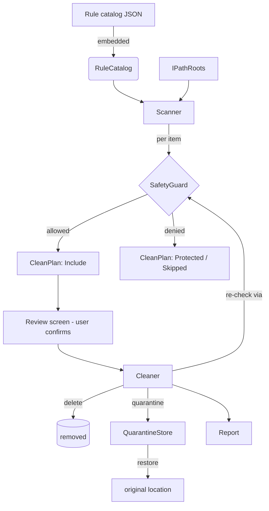

# IVX Clean — Architecture

## Layers

```
IvxClean.Core   (no UI)   Paths, Safety, Rules, Scanning, Cleaning, Quarantine, SystemOps, Software
IvxClean.App    (WPF-UI)  MVVM views/view-models, DI host, theming, settings, dialogs
IvxClean.Cli              Scan-only console (JSON report), for QA/automation
tools/RulesDocGen         Generates docs/RULES.md from the catalog
```

`Core` has **no dependency on WPF**. Everything that touches the outside world is behind an interface
(`IPathRoots`, `IClock`, `IProcessInspector`, `IServiceController`, `IRestorePointService`,
`IQuarantineStore`, `IInstalledSoftwareSource`, …) so the whole engine is testable with fakes. The app
wires concrete implementations through `Microsoft.Extensions.DependencyInjection`.

## The safety model

Nothing is deleted that does not pass **two gates**:

1. **Allowlist (rules).** A location is only a candidate if a reviewed rule in the catalog names it.
2. **SafetyGuard.** Every candidate is evaluated at scan time *and again immediately before deletion*
   (time-of-check/time-of-use defense). It denies on canonicalization failure, UNC/device/ADS forms,
   reparse points (including any intervening directory and final-path redirection), paths outside the
   rule's resolved base, protected system roots, protected user folders (Known Folders + OneDrive),
   user-defined protected folders, protected file/folder patterns, cloud placeholders, and files newer
   than the rule's minimum age. **When in doubt, it denies.**

A bug in a rule is caught by the guard. A bug in the guard is caught by the test suite (adversarial +
junction-attack tests). A rule that points anywhere protected fails the catalog safety test and cannot
ship.

## Data flow



## Projects & key types

- **Paths** — `IPathRoots` (tokens → real paths), `ProductionPathRoots`, sandbox roots for tests.
- **Safety** — `SafetyGuard`, `SafetyDecision`/`DenyReason`, `ProtectedPatterns` (`rules/protected.json`),
  `PathResolver` (reparse/final path), `KnownFolders`.
- **Rules** — `Rule`/`RuleTarget`, `RuleCatalog`, `RuleValidator` (+ `rules/schema.json`).
- **Scanning** — `Scanner` (read-only), `CleanPlan`, `PlanItem`, `SafeFileEnumerator`.
- **Cleaning** — `Cleaner`, `CleanReport`.
- **Quarantine** — `QuarantineStore`, `QuarantineManifest`.
- **SystemOps** — `ServicesManager` (+ crash marker), restore point (WMI), DISM, event logs, Recycle Bin.
- **Software** — registry + AppX inventory, `SoftwareClassifier` (`rules/software.json`), `UninstallCommand`.
